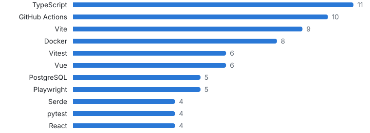
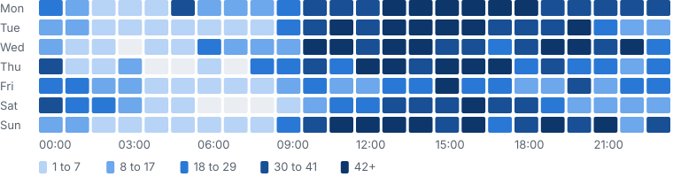

<!-- Generated by profile/render.mjs from site/src/data/site.ts and profile/stats.json. Edit those, not this file. The site's own README is SITE.md. -->

Software engineer in Istanbul and MSc student in computer engineering at Boğaziçi University. What I work on, the research and the projects are on [leventaksakal.com](https://leventaksakal.com). [LinkedIn](https://www.linkedin.com/in/levent-aksakal-85b450236) · [leventaksakal56@gmail.com](mailto:leventaksakal56@gmail.com)

### The last twelve months

<picture><source media="(prefers-color-scheme: dark)" srcset="profile/figures-dark.svg"></picture>

 

<picture><source media="(prefers-color-scheme: dark)" srcset="profile/year-dark.svg"></picture>

17 Nov 2025 to 19 Nov 2026, counted from the 40 git repositories on my machine, public and private. The longest run of days with a commit is 26; the busiest day had 241, on 28 Oct 2026. I work with coding agents: these are the commits and lines made under my name, by me and by the agents I run.

### Languages and tools

<picture><source media="(prefers-color-scheme: dark)" srcset="profile/languages-dark.svg"></picture>

1,653,296 non-blank lines of source in 37 repositories, as they stand today. Beside them stand 200,942 lines of Markdown: ledgers, decisions and briefs. In the twelve months 2.84M lines of source were added and 1.1M removed.

 

<picture><source media="(prefers-color-scheme: dark)" srcset="profile/tools-dark.svg"></picture>

The number of repositories whose manifests name the tool, of 37.

### When the commits land

<picture><source media="(prefers-color-scheme: dark)" srcset="profile/hours-dark.svg"></picture>

Local time. The busiest hour is 13:00 to 14:00; 26% of the commits fall on a weekend.

How the numbers are counted

 

Counted on 19 Nov 2026 by [`profile/collect.mjs`](profile/collect.mjs) and drawn by [`profile/render.mjs`](profile/render.mjs); the numbers are in [`profile/stats.json`](profile/stats.json).

- A commit is a non-merge commit on `main`, `master`, `stage` or the branch checked out, made under my name. Commits that only exist on other branches are not counted.
- A repository counts as mine when I wrote at least 60% of the commits that people wrote in it. Lines and tools are counted only there.
- A line is a non-blank line in a tracked source file. Lock files, generated files, vendored code, design exports, the work folders of coding agents, data and notebooks are left out.
- A tool is counted once per repository whose `package.json`, `Cargo.toml`, `pyproject.toml`, `requirements.txt` or `go.mod` names it; Docker and GitHub Actions by their files.

