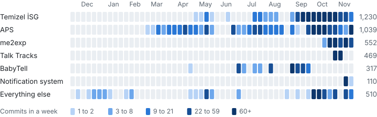
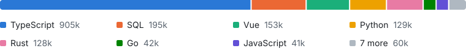

<!-- Generated by profile/render.mjs from site/src/data/site.ts and profile/stats.json. Edit those, not this file. The site's own README is SITE.md. -->

Software engineer in Istanbul and MSc student in computer engineering at Boğaziçi University. What I work on, the research and the projects are on [leventaksakal.com](https://leventaksakal.com). [LinkedIn](https://www.linkedin.com/in/levent-aksakal-85b450236) · [leventaksakal56@gmail.com](mailto:leventaksakal56@gmail.com)

### The last twelve months

<picture><source media="(prefers-color-scheme: dark)" srcset="profile/figures-dark.svg"></picture>

 

<picture><source media="(prefers-color-scheme: dark)" srcset="profile/year-dark.svg"></picture>

 

<picture><source media="(prefers-color-scheme: dark)" srcset="profile/languages-dark.svg"></picture>

17 Nov 2025 to 19 Nov 2026, from the 40 git repositories on my machine, public and private; the bar is the 1,653,910 lines of source standing in them today. I work with coding agents: these are the commits and lines made under my name, by me and by the agents I run.

How the numbers are counted

 

Counted on 19 Nov 2026 by [`profile/collect.mjs`](profile/collect.mjs) and drawn by [`profile/render.mjs`](profile/render.mjs); the numbers are in [`profile/stats.json`](profile/stats.json).

- A commit is a non-merge commit on `main`, `master`, `stage` or the branch checked out, made under my name. Commits that only exist on other branches are not counted.
- A repository counts as mine when I wrote at least 60% of the commits that people wrote in it. Lines are counted only there.
- A line is a non-blank line in a tracked source file. Lock files, generated files, vendored code, design exports, the work folders of coding agents, data, notebooks and Markdown are left out.

